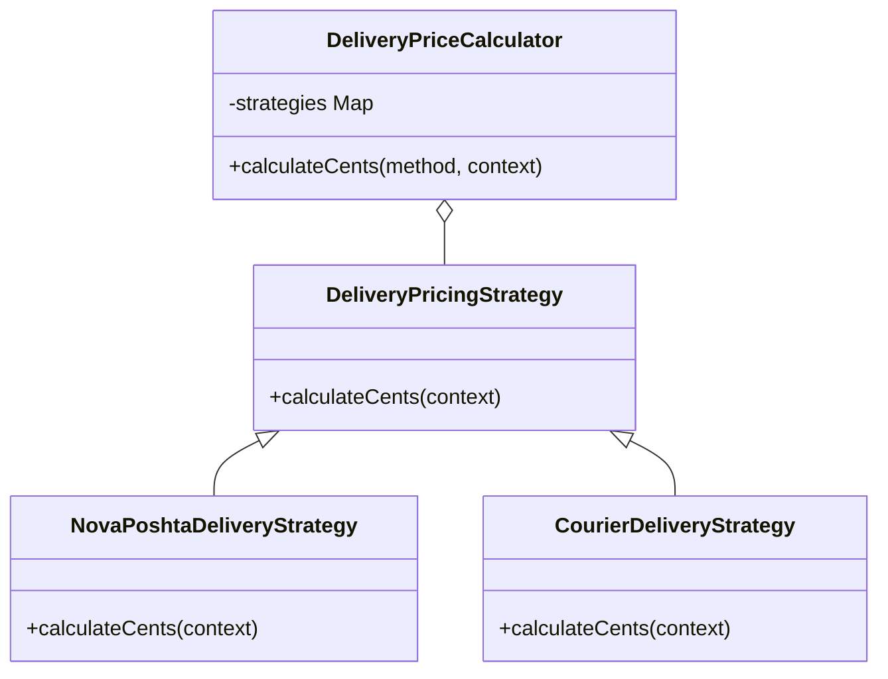
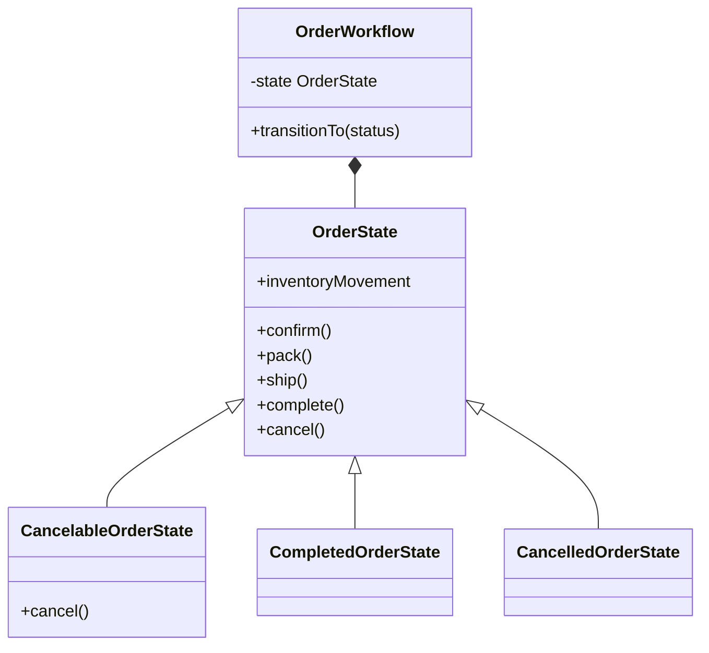
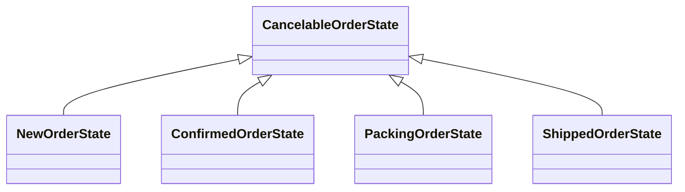

# Архітектура бізнес правил FORMA

## Межі відповідальності

React працює через відносні `/api`. Express перевіряє запит, роль і дані, а модуль `orders.js` організовує SQL-транзакцію. PostgreSQL зберігає робочий стан у схемі `forma`. Модулі `patterns/` визначають правила без доступу до БД або HTTP; маршрут застосовує їхній результат у поточній транзакції.

Рефакторинг лабораторної 12 не змінює маршрутів, JSON-контракту, назв статусів, тарифів чи схеми БД.

## Strategy для вартості доставки

До змін `orders.js` містив умову «Нова пошта і сума від 2500 — безкоштовно, інакше тариф БД». Вона пов’язувала вибір алгоритму з оформленням і резервуванням. Для перевірки граничної суми доводилося проходити весь сценарій замовлення.

Після змін `DeliveryPriceCalculator` вибирає стратегію з `Map` і викликає спільний метод `calculateCents(context)`. `NovaPoshtaDeliveryStrategy` застосовує поріг 250000 копійок; `CourierDeliveryStrategy` повертає базовий тариф. Обидві реалізації наслідують `DeliveryPricingStrategy`. Калькулятор перевіряє невід’ємні безпечні цілі числа на вході й виході.

Контекст має `subtotalCents` та `basePriceCents`; останній надходить з активного запису `delivery_methods`. Калькулятор не зберігає кошик чи користувача між запитами. Реєстр можна передати через конструктор; додаткова стратегія в тесті демонструє підстановку без змін калькулятора.

Виграш: алгоритми можна перевіряти окремо, а транзакція оформлення не знає формул доставки. Компроміс: для двох простих формул з’являються додаткові класи. Новий публічний спосіб доставки все одно потребуватиме узгодження довідника БД, Zod-схеми й клієнтського вибору; реєстрація класу не додає таку функцію автоматично.

## State для замовлення

До змін маршрут перевіряв таблицю `transitions`, а потім окремими умовами визначав складські наслідки. Дозволені переходи й наслідки завершення були описані в різних місцях одного HTTP-обробника.

Після змін `OrderWorkflow` відновлює поточний об’єкт стану з рядка БД і делегує дію стану. Базовий `OrderState` забороняє дії з HTTP 409. Кожний конкретний стан перевизначає лише дозволений наступний крок; `CancelableOrderState` дозволяє спільне скасування для чотирьох незавершених станів. Після успішної дії контекст приймає новий стан.

Чотири незавершені стани успадковують спільну операцію скасування:

| Стан | Дія | Новий стан | Складський наслідок |
| --- | --- | --- | --- |
| Нове | `confirm` | Підтверджене | Немає |
| Підтверджене | `pack` | Комплектується | Немає |
| Комплектується | `ship` | Відправлене | Немає |
| Відправлене | `complete` | Виконане | `FULFILL` |
| Будь-який із чотирьох незавершених | `cancel` | Скасоване | `RELEASE` |
| Виконане або Скасоване | Будь-яка | Відмова 409 | Немає повторного застосування |

Значення `inventoryMovement` описує наслідок **входу** в новий стан, а не наказ повторно застосувати рух для завантаженого запису. Маршрут читає його лише після успішного `transitionTo`. SQL залишається всередині транзакції після `SELECT ... FOR UPDATE`; класи станів не змінюють запаси самостійно. Повторне виконання відхиляється до повторного списання.

Перевірка ролі, наявності замовлення та причини скасування залишається в маршруті. Резерви, історія статусів, аудит і outbox зберігаються атомарно. Патерн не замінює блокування БД або валідацію HTTP.

Виграш: допустима поведінка локалізована у станах; термінальні стани забороняють усі подальші дії. Компроміс: класів більше, ніж у компактній таблиці переходів, і новий статус потребує узгодження класу, реєстру, API-валидації та обмеження БД. Для незмінного короткого workflow таблиця також є коректним рішенням; State обрано для явного відокремлення поведінки та майбутніх правил станів.

## Контроль регресій

Вихідний commit `9dc8b2b3c22b24f00c970a0305ce8a360b1714f4`, локальна гілка `lab12/strategy-and-state`. Усі 25 попередніх тестів збережено. Додано 8 перевірок правил у `server/test/patterns.test.js`, разом 33. Перевірено `npm test`, `npm run build`, `npm --prefix server run check` та HTTP-сценарій зібраного клієнта з PGlite. UML до і після змін наведено в звіті.
